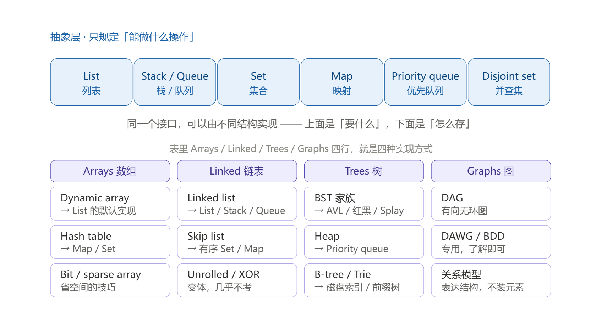

# Chapter 18 & 19 & 20

# Priority Queues and Heaps

priority queue(PQ): 优先队列

heap: 堆

## 新的数据结构引入: to implement MinPQ Interface

用一个具体的应用场景作为背景（**实现最小优先队列这一抽象数据结构**），分析现成的BST、HashTable、Ordered Array三种数据结构在此问题上的复杂度。
```java
public interface MinPQ<Item> {
    public void add(Item x);
    public Item getSmallest();
    public Item removeSmallest();
    public int size();
}
```
发现：均不能满足应用实际，所以有了接下来要讲的新的数据结构。

## 由 BSTs -> (binary min-)Heaps

之前的结论是“最好的现成方案是 BST，三项都 log N”。但还不够，教材常识改进它以期望得到更好的性能表现。

min-heap 就是通过修改它的结构和约束得到的。

BST 有两条约束：“每个节点最多两个孩子” 以及 “左子树全体 < 节点 < 右子树全体” 。堆把第 2 条限制放宽松了： 堆只管父子的大小关系，不管兄弟之间的大小关系。

上述条件的堆就是 `Binary min-heap`: Binary tree that is `complete` and obeys `min-heap` property.
- `Min-heap`: Every node is less than or equal to both of its children.（每个节点 ≤ 它的两个孩子）
- `Complete`: Missing items only at the bottom level (if any), all nodes are as far left as possible.（只在最底层缺，且所有节点尽量靠左）
    - 最底层以上的每一层必须填满。
    - 最底层必须从左往右填充，不能中间空一个再填一个。

binary min-heap实现MinPQ接口：
- add：放到下一个空位（也就是最后一个位置，complete 决定了它在哪）→ 一路 `swim`（上浮）
- getSmallest：直接返回根。min-heap 能够保证根最小。
- removeSmallest：把最后一个元素搬到根，然后删除最后的那一个节点 → 新的根节点一路 `sink`（下沉）

二叉最小堆是BST的改进，那说明二叉最小堆也是树。树在内存中如何存储？—— Tree Representation。该选择哪种存储方式呢？

## Tree Representation

Two types: Recursive Representation or Array Representation

`Approach 1`: create mapping from node to children. (recursive representation)存储了显式指针
- 1a: Fixed-Width nodes
- 1b: Variable-Width nodes
- 1c: Sibling Tree

```java

```

`Approach 2`: Store keys in an array. Store parentIDs(index in the array of keys) in an array.
- Similar to what we did with `disjointSets`.

```java

```

`Approach 3`: Store keys in an array.
- 3a: Store keys in an array. Don’t store structure anywhere.
  - To interpret array: Simply assume tree is complete.
  - Obviously only works for “complete” trees.
  - Challenge: get parent's ID(index) by the child's ID(index). `parentID =  (childId - 1) / 2`
- 3b: Store keys in an array. Offset everything by 1 spot.
  - Same as 3, but leave spot 0 empty.
  - Makes computation of children/parents “nicer”.
    - leftChild(k) = k*2
    - rightChild(k) = k*2 + 1
    - parent(k) = k/2

```java

```

## Heap implementation of Priority Queue

通过分析树的表示以及存储方式，用binary min-heap实现优先队列，应该选择：approach 3对应数组表示方法来存储树。

相较于BST，既节省内存，有提高了一部分时间性能。

## Data Structure Summary



#  Tree, Graphs, and Traversals

## Trees and Traversals

### Tree Definition

树的定义：树 = 连通 + 无环。等价说法是“任意两点只有一条路”。
- 一组连通的节点（也称作顶点）
- 一组连接这些节点的边，没有边能构成环，也即：任意两点之间恰好一条路径

有根树（rooted tree）：树 + 指定一个根（一般画在最上面）
- parent：除根以外，每个节点恰好一个
- child：0 个或多个。0 个孩子叫叶子（leaf）

### Tree Traversals

it is named traversal with no real reason.

树的遍历没有唯一的自然顺序，树有许多种自然顺序可以遍历：
- Level Order：层序遍历，也叫BFS。顺序是：逐层、从左往右。
- DFS：深度优先搜索，分为三种。
  - pre-order：前序遍历。规则：先访问自己，再左，再右。
  - in-order：中序遍历。规则：左，然后自己，然后右。
  - post-order：后序遍历。规则：左，右，然后自己。

层序遍历的实现比其他三种的实现都要复杂。

下面是举例说明，树形状如下：
```
        D
      /   \
     B     F
    / \   / \
   A   C E   G
```
1. 层序遍历：
    ```
    第 0 层：D
    第 1 层：B、F
    第 2 层：A、C、E、G
    → D B F A C E G
    ```
2. 前序遍历
    ```
    preOrder(BSTNode x) {
        if (x == null) return;
        print(x.key)
        preOrder(x.left)
        preOrder(x.right)
    }

    先 D，往左到 B（打印 B），往左到 A（打印 A，A 没孩子，回去）。
    回 B 往右到 C（打印 C，回去）。
    左半边完了。
    回到 D 往右到 F（打印 F），左 E（打印），右 G（打印）。
    → D B A C F E G
    ```
3. 中序遍历
    ```
    inOrder(BSTNode x) {
        if (x == null) return;    
        inOrder(x.left)
        print(x.key)
        inOrder(x.right)
    }
   
   [左子树那一串] + D + [右子树那一串]
   递归展开[左子树那一串]：到 B 上，它是 [B 的左] + B + [B 的右] = A + B + C = A B C。同理可得右子树。

    拼接后得到 -> A B C D E F G
    ```
4. 后序遍历
    ```
    postOrder(BSTNode x) {
        if (x == null) return;    
        postOrder(x.left)
        postOrder(x.right)
        print(x.key)   
    }

    拼法：[左] + [右] + D
    [左] 是 B 子树的后序 = A C B；[右] 是 F 子树的 = E G F。
    → A C B + E G F + D = A C B E G F D
    ```

Traversal Summary:
- 树有四种自然访问顺序，三个BFS递归函数只差 print 那一行。
- 四种遍历的类比：遍历就是清点一栋楼。
  - 层序 = 一层一层查
  - 三种 DFS = 沿着一个单元走到底再回头。区别只在“什么时候登记”：进门就登（pre）、左边查完就登（in）、两边都查完才登（post）。
- **Traversal的应用**：把 print 换成任何“办事”动作（累加、改值、存盘、删节点），“序”的含义就跟着扩展了。*遍历 + 想要的操作*才是学习遍历的用处。
  - 访问根、左、右的不同意味着处理/操作节点的先后不同：前序遍历实现处理根节点->左孩子 -> 右孩子的顺序（例如打印目录/树结构）。后序遍历则是先处理左右孩子，最后再来处理根节点（例如删除、求高度大小）。
- in-order 等于有序，只在 BST 上成立。在普通二叉树上中序照样能跑，但没有“有序”这个结果了。

## Graphs and Traversals

### Graph Definition

图由两部分组成：
- 一组节点（也叫顶点）
- 零条或更多边，每条边连接两个节点

图可以完全不相连（分成好几块各管各的），而树要求连通 。图可以有环，而树禁止有环。因此，可以说：图是去掉了“唯一路径”和“必须连通”这两条约束的树。

图的分类：
- 简单图、多重图：简单图禁止“两节点间多重边”和“节点自环”。
- 边有没方向：无向图和有向图。
- 有没有环：无环图（acyclic）和有环图（cyclic）。
- 是否有环和是否有方向可以组合出四种图，如有向无环图。

### Graph Problems: 九个经典问题

关于图，有几个经典问题。这些问题涵盖了大部分图的使用。
- s-t Path:	s 到 t 有没有路
- Connectivity:	整张图连不连通（任意两点是否都有路）
- Biconnectivity: 有没有哪个点，删掉它图就断成两半
- Shortest s-t Path: s 到 t 的最短路
- Cycle Detection: 有没有环
- Euler Tour: 有没有一个环，每条边正好走一次
- Hamilton Tour: 有没有一个环，每个点正好走一次
- Planarity: 能不能画在纸上不让边交叉
- Isomorphism: 两张图是不是“同一张图换了张皮”


Example: s-t Path: s, t 两点之间是否存在路径。 connected(s, t)
```
connected(s, t) {
    mark s                                    // 记住我来过
    if (s == t): return true;
    for child in unmarked_neighbors(s):       // 标记过的一律跳过
        if isconnected(child, t): return true;
    return false;
}
```

### BFS and DFS

`BFS`(Breadth First Search): 广度优先搜索。

`DFS`(Depth First Search): 深度优先搜索。

BFS搜索算法的伪代码如下：
```
Initialize the fringe, an empty queue 
    add the starting vertex to the fringe
    mark the starting vertex              ← ★ 这一行：进入fringe时就标记了
    while fringe is not empty:
        remove vertex v from the fringe
        for each neighbor n of vertex v:
            if n is not marked:
                add n to fringe
                mark n
                set edgeTo[n] = v                 // 我是从哪来的
                set distTo[n] = distTo[v] + 1     // 我离起点有多远
```
DFS搜索算法的伪代码如下：
```
Initialize the fringe, an empty stack
    push the starting vertex on the fringe
    while fringe is not empty:
        pop a vertex off the fringe
        if vertex is not marked: ← ★ 这一行：发生在出栈后。出栈后才标记。
            mark the vertex
            visit vertex
            for each neighbor of vertex:
                if neighbor not marked:
                    push neighbor to fringe
```
循环里只做两件事： 从 fringe 里取出一个元素，然后把它尚未标记的邻居塞进去。

两种遍历的差别不只是容器，还在于标记时机：
- fringe的不同，代码实现的算法也就不同：
  - fringe是queue（队列）：BFS
  - fringe是stack（栈）：DFS
- 标记时机：
  - BFS：入队时就标记。一个顶点最多进队一次。
  - DFS：出栈才标记。同一个顶点可以在栈中出现多次。
